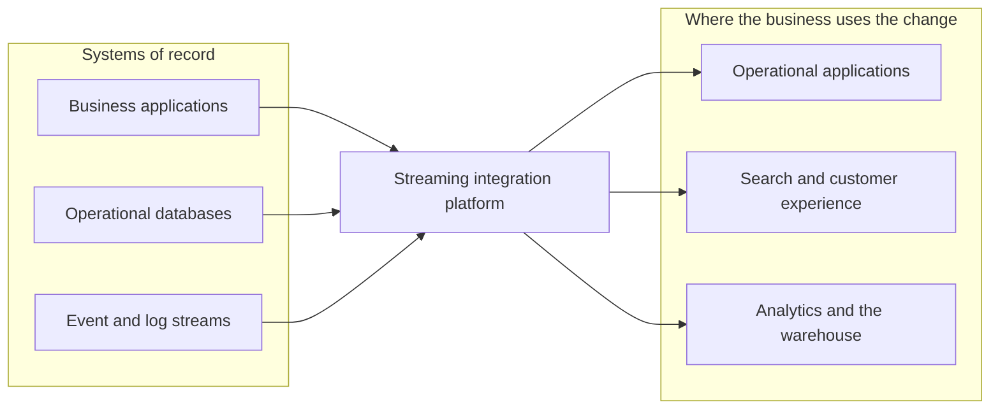

# Business context

A streaming integration platform sits between the systems that record what the business did and the systems that need that change while it is still useful.

Domain teams keep owning their sources. The platform team owns the path: isolated runtimes, a shared contract for the data, and a rule that bad records are quarantined instead of stopping the flow. New pipelines are declared and reviewed. They are not hand-built on a shared server.

## Context diagram

## How to read it

The left side is anything that already knows a fact: an order was placed, a record changed, a service emitted an event. The center is the only supported way to carry that fact out. The right side is every team that needs the fact without taking a private copy of the source system.

One shared Connect cluster is intentionally not the design. Capture, heavy exports, search indexing, and experiments run in separate tiers so one workload cannot stall another.

## What changes for the business

| Today | With the platform |
| --- | --- |
| Each team builds and operates its own copy job | Teams declare a pipeline; the platform runs it |
| A heavy export can stall a time-critical capture | Workloads are isolated by failure domain |
| A bad record stops the whole feed | The bad record is quarantined and the feed continues |
| Credentials and connector config live in tickets and scripts | Config is reviewed in Git; secrets stay in a secrets store |

## LinkedIn caption

You can paste this and attach a screenshot of the diagram. LinkedIn does not render the diagram source above.

> Most integration estates grow as a pile of one-off copy jobs. Each team runs its own, and a single heavy export can stall the feed the business actually waits on.
>
> The shift is to treat streaming integration as a platform. Systems of record stay with the domain teams. A shared tier carries committed change to operational apps, search, and the warehouse. Pipelines are declared and reviewed. Bad records are quarantined. Critical capture does not share a runtime with bulk exports.
>
> The result is quieter operations: domain teams onboard a pipeline, and the platform team owns the guardrails.
