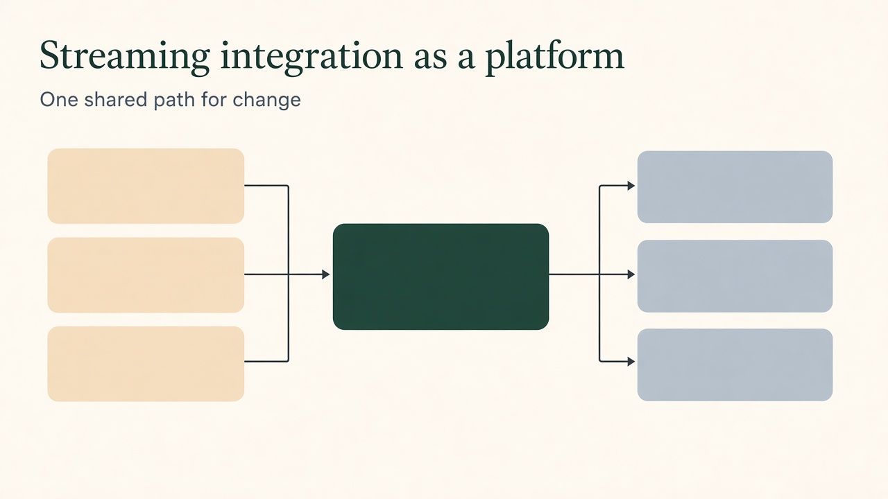

# Streaming integration as a platform

A plain explanation of how a business change moves from the system that recorded it to the systems that need it, with agents doing the routine work through one shared toolbox.

## The big picture (in one minute)

Think of this platform as the shared path for change. An order is placed, a record is updated, or a service writes a log. Those facts stay with the teams that own them. The platform carries the change to the applications, the search tools, and the warehouse that need it while it is still useful.

Specialist agents do the routine work. They do not call the source systems, Kafka, or the destinations on their own. They call tools on one shared toolbox, an MCP server. Rules come first. A safe change can run quietly. A risky change waits for a person.

Teams describe a pipeline. They do not build their own copy job. A bad record is set aside, so the rest of the feed keeps moving. A heavy export runs on its own, so it cannot slow down the capture the business is waiting on.

## 1. The problem it solves

Most integration setups grow as a pile of one-off copy jobs.

- Each team builds and runs its own copy from the source system.
- One shared pool of workers means a heavy export can stall a time-critical feed.
- A single bad record can stop the whole flow.
- Settings and passwords live in tickets and scripts.
- A restart or an upgrade pauses the pipeline, because the worker kept its place on the machine.
- Every downstream team takes a private copy of the source.

Routine movement of change should be one supported path, with clear rules. Risky work, such as a large export or an experiment, should not be able to stop that path.

## 2. How this differs from the old way

The old way is a set of private copy jobs. This design is one shared path. Agents do the routine steps. The heavy work is kept apart so one pipeline cannot stall the rest.

| The old way | This platform |
| --- | --- |
| Each team builds and runs its own copy | Teams keep the source. They describe a pipeline, and the platform runs it |
| People hand-build every copy job | Agents do the routine work through one shared toolbox, the MCP server |
| All connectors share one pool of workers | Capture, large exports, search updates, and experiments each run on their own |
| Settings and passwords live in scripts and tickets | Settings are reviewed in Git. Passwords stay in a secrets store |
| A bad record or a heavy export stops the feed | The bad record is set aside. A large writer cannot stall a time-critical capture |
| A restart or upgrade pauses the pipeline | Agents do not keep data on the machine. They resume from the log |
| Each reader takes its own copy of the source | Applications, search, and the warehouse read the same committed change |

## 3. How it works

Rules decide. Agents call tools. Kafka remembers the business records and the agents' place in the stream.

1. **Sources.** Operational databases, change data capture, and application or log streams. The platform reads the change. It does not keep a private copy of the source.
2. **MCP server.** The only toolbox the agents share. The tools are simple: read a source, publish a record, check the schema, set a bad record aside, and write to a sink. Agents do not reach around the toolbox.
3. **Three agents for the record.** The source agent reads the committed change. The transform agent masks a field, routes the record, or fixes a timestamp, then writes it as Avro or Protobuf. The sink agent writes it onward so a replay does not create a duplicate.
4. **Rules agent.** A safe change runs quietly. A risky change waits for a person, with a short explanation. The rule book makes that call. The model does not.
5. **Kafka.** Business records go to data topics. The agents' notes — configuration, position, and status — go beside them. Agents keep nothing on the machine, so a restart continues from the log.
6. **When something is wrong.** The schema check uses a shared contract, so readers do not break. A record that cannot be written is set aside with context. The rest of the feed continues.
7. **Sinks.** Search, object storage, the warehouse, and downstream applications each run on their own. A heavy batch writer cannot stall a time-critical capture.

Passwords stay in a secrets store. The tool reads them when it runs. Nothing secret is stored in Git.

## 4. What the business gets

- New pipelines start by describing them. Domain teams stop running their own copy jobs.
- Routine changes run quietly. A person is asked only when the change is risky.
- Applications, search, and the warehouse see the same change while it is still useful.
- A heavy export or a bad record no longer takes down the feed the business is waiting on.
- Source databases stay healthier. A stalled capture is what lets transaction logs grow until the disk fills.
- Every pipeline change can be reviewed. Passwords never sit in the repository.
- Agents can be restarted without losing their place, because that place lives in Kafka.

## 5. Business context

The left side is anything that already knows a fact. The center is the only supported way to carry that fact out. The right side is every team that needs the fact without taking a private copy of the source.

<svg xmlns="http://www.w3.org/2000/svg" viewBox="0 0 1120 420" role="img" aria-labelledby="bc-title bc-desc">
  <title id="bc-title">Business context</title>
  <desc id="bc-desc">Systems of record feed a streaming integration platform, which carries committed change to operational applications, search, and the warehouse.</desc>
  <defs>
    <marker id="bc-arrow" viewBox="0 0 10 10" refX="9" refY="5" markerWidth="7" markerHeight="7" orient="auto">
      <path d="M0 0 L10 5 L0 10 Z" fill="#5e6b64"/>
    </marker>
  </defs>
  <rect width="1120" height="420" fill="#fbfaf7"/>

  <rect x="24" y="24" width="320" height="372" rx="14" fill="#f7f3ec" stroke="#e0d5c4"/>
  <text x="44" y="56" fill="#8a735c" font-family="Helvetica, Arial, sans-serif" font-size="12" font-weight="700" letter-spacing="0.6">SYSTEMS OF RECORD</text>
  <rect x="44" y="76" width="280" height="72" rx="12" fill="#fffdf8" stroke="#d9cbb6"/>
  <text x="184" y="118" text-anchor="middle" fill="#1b2420" font-family="Helvetica, Arial, sans-serif" font-size="15">Business applications</text>
  <rect x="44" y="164" width="280" height="72" rx="12" fill="#fffdf8" stroke="#d9cbb6"/>
  <text x="184" y="206" text-anchor="middle" fill="#1b2420" font-family="Helvetica, Arial, sans-serif" font-size="15">Operational databases</text>
  <rect x="44" y="252" width="280" height="72" rx="12" fill="#fffdf8" stroke="#d9cbb6"/>
  <text x="184" y="294" text-anchor="middle" fill="#1b2420" font-family="Helvetica, Arial, sans-serif" font-size="15">Event and log streams</text>
  <text x="44" y="356" fill="#5e6b64" font-family="Helvetica, Arial, sans-serif" font-size="12">The systems that already know a fact.</text>

  <rect x="420" y="146" width="280" height="128" rx="16" fill="#1f3d34"/>
  <text x="560" y="198" text-anchor="middle" fill="#f4efe6" font-family="Helvetica, Arial, sans-serif" font-size="16" font-weight="700">Streaming integration</text>
  <text x="560" y="220" text-anchor="middle" fill="#f4efe6" font-family="Helvetica, Arial, sans-serif" font-size="16" font-weight="700">platform</text>
  <text x="560" y="246" text-anchor="middle" fill="#c9d8cf" font-family="Helvetica, Arial, sans-serif" font-size="12">The supported path for change</text>

  <rect x="776" y="24" width="320" height="372" rx="14" fill="#f4f6f8" stroke="#d3dae1"/>
  <text x="796" y="56" fill="#4d6274" font-family="Helvetica, Arial, sans-serif" font-size="12" font-weight="700" letter-spacing="0.4">WHERE THE BUSINESS USES THE CHANGE</text>
  <rect x="796" y="76" width="280" height="72" rx="12" fill="#fffdf8" stroke="#cfd6de"/>
  <text x="936" y="118" text-anchor="middle" fill="#1b2420" font-family="Helvetica, Arial, sans-serif" font-size="15">Operational applications</text>
  <rect x="796" y="164" width="280" height="72" rx="12" fill="#fffdf8" stroke="#cfd6de"/>
  <text x="936" y="198" text-anchor="middle" fill="#1b2420" font-family="Helvetica, Arial, sans-serif" font-size="15">Search and customer</text>
  <text x="936" y="218" text-anchor="middle" fill="#1b2420" font-family="Helvetica, Arial, sans-serif" font-size="15">experience</text>
  <rect x="796" y="252" width="280" height="72" rx="12" fill="#fffdf8" stroke="#cfd6de"/>
  <text x="936" y="294" text-anchor="middle" fill="#1b2420" font-family="Helvetica, Arial, sans-serif" font-size="15">Analytics and the warehouse</text>
  <text x="796" y="356" fill="#5e6b64" font-family="Helvetica, Arial, sans-serif" font-size="12">No private copy of the source.</text>

  <path d="M324 112 H372 V210 H420" fill="none" stroke="#5e6b64" stroke-width="1.5" marker-end="url(#bc-arrow)"/>
  <path d="M324 200 H372" fill="none" stroke="#c4b49a" stroke-width="1.5"/>
  <path d="M324 288 H372 V210" fill="none" stroke="#c4b49a" stroke-width="1.5"/>
  <path d="M700 210 H748 V112 H776" fill="none" stroke="#5e6b64" stroke-width="1.5" marker-end="url(#bc-arrow)"/>
  <path d="M748 210 H776" fill="none" stroke="#5e6b64" stroke-width="1.5" marker-end="url(#bc-arrow)"/>
  <path d="M748 210 V288 H776" fill="none" stroke="#5e6b64" stroke-width="1.5" marker-end="url(#bc-arrow)"/>
</svg>

## 6. Agentic architecture

Sources feed three agents. Those agents share the MCP server and call its tools. The rules agent lets a safe change run quietly and holds a risky one for a person. Kafka holds the business stream and the agents' notes. A schema check protects readers. Bad records are set aside. Each destination runs on its own, so one workload cannot stall another.

<svg xmlns="http://www.w3.org/2000/svg" viewBox="0 0 1580 700" role="img" aria-labelledby="ag-title ag-desc">
  <title id="ag-title">Agentic architecture with an MCP server</title>
  <desc id="ag-desc">Sources feed a source agent, a transform agent, and a sink agent. Those agents share one MCP server as their toolbox. Kafka holds the business stream and the agents' notes. Rules, the schema contract, and bad records stay beside the flow. Sinks receive the change.</desc>
  <defs>
    <marker id="ag-arr" viewBox="0 0 10 10" refX="8" refY="5" markerWidth="7" markerHeight="7" orient="auto">
      <path d="M0 1 L8 5 L0 9 Z" fill="#5e6b64"/>
    </marker>
    <marker id="ag-green" viewBox="0 0 10 10" refX="8" refY="5" markerWidth="7" markerHeight="7" orient="auto">
      <path d="M0 1 L8 5 L0 9 Z" fill="#2f6a4e"/>
    </marker>
    <marker id="ag-gold" viewBox="0 0 10 10" refX="8" refY="5" markerWidth="7" markerHeight="7" orient="auto-start-reverse">
      <path d="M0 1 L8 5 L0 9 Z" fill="#8a6230"/>
    </marker>
    <marker id="ag-rust" viewBox="0 0 10 10" refX="8" refY="5" markerWidth="7" markerHeight="7" orient="auto">
      <path d="M0 1 L8 5 L0 9 Z" fill="#8d5348"/>
    </marker>
    <marker id="ag-slate" viewBox="0 0 10 10" refX="8" refY="5" markerWidth="7" markerHeight="7" orient="auto">
      <path d="M0 1 L8 5 L0 9 Z" fill="#4d6274"/>
    </marker>
  </defs>
  <rect width="1580" height="700" fill="#fbfaf7"/>

  <rect x="16" y="16" width="210" height="668" rx="14" fill="#f7f3ec" stroke="#e0d5c4"/>
  <text x="32" y="44" fill="#8a735c" font-family="Helvetica, Arial, sans-serif" font-size="11" font-weight="700" letter-spacing="0.5">EXTERNAL SOURCES</text>
  <rect x="32" y="64" width="178" height="58" rx="12" fill="#fffdf8" stroke="#d9cbb6"/>
  <text x="121" y="98" text-anchor="middle" fill="#1b2420" font-family="Helvetica, Arial, sans-serif" font-size="13">Operational databases</text>
  <rect x="32" y="138" width="178" height="58" rx="12" fill="#fffdf8" stroke="#d9cbb6"/>
  <text x="121" y="172" text-anchor="middle" fill="#1b2420" font-family="Helvetica, Arial, sans-serif" font-size="13">Change data capture</text>
  <rect x="32" y="212" width="178" height="64" rx="12" fill="#fffdf8" stroke="#d9cbb6"/>
  <text x="121" y="238" text-anchor="middle" fill="#1b2420" font-family="Helvetica, Arial, sans-serif" font-size="13">Application and</text>
  <text x="121" y="256" text-anchor="middle" fill="#1b2420" font-family="Helvetica, Arial, sans-serif" font-size="13">log streams</text>
  <text x="32" y="312" fill="#5e6b64" font-family="Helvetica, Arial, sans-serif" font-size="12">
    <tspan x="32" dy="0">Systems of record.</tspan>
    <tspan x="32" dy="18">The platform reads</tspan>
    <tspan x="32" dy="18">committed change.</tspan>
  </text>

  <rect x="246" y="16" width="700" height="668" rx="14" fill="#f3f7f4" stroke="#c9d8cf"/>
  <text x="266" y="44" fill="#2f6a4e" font-family="Helvetica, Arial, sans-serif" font-size="11" font-weight="700" letter-spacing="0.5">AGENTIC LAYER</text>
  <rect x="266" y="58" width="660" height="72" rx="12" fill="#1f3d34"/>
  <text x="596" y="86" text-anchor="middle" fill="#f4efe6" font-family="Helvetica, Arial, sans-serif" font-size="16" font-weight="700">MCP server</text>
  <text x="596" y="108" text-anchor="middle" fill="#c9d8cf" font-family="Helvetica, Arial, sans-serif" font-size="12">Shared toolbox: read source, publish, check schema, set aside, write sink</text>

  <rect x="266" y="168" width="190" height="84" rx="12" fill="#fffdf8" stroke="#b7c9be"/>
  <text x="361" y="202" text-anchor="middle" fill="#1b2420" font-family="Helvetica, Arial, sans-serif" font-size="14" font-weight="700">Source agent</text>
  <text x="361" y="222" text-anchor="middle" fill="#5e6b64" font-family="Helvetica, Arial, sans-serif" font-size="12">Reads committed change</text>
  <rect x="486" y="168" width="210" height="84" rx="12" fill="#fffdf8" stroke="#b7c9be"/>
  <text x="591" y="198" text-anchor="middle" fill="#1b2420" font-family="Helvetica, Arial, sans-serif" font-size="14" font-weight="700">Transform agent</text>
  <text x="591" y="218" text-anchor="middle" fill="#5e6b64" font-family="Helvetica, Arial, sans-serif" font-size="12">Mask, route, normalize</text>
  <text x="591" y="234" text-anchor="middle" fill="#5e6b64" font-family="Helvetica, Arial, sans-serif" font-size="12">Avro or Protobuf</text>
  <rect x="726" y="168" width="180" height="84" rx="12" fill="#fffdf8" stroke="#b7c9be"/>
  <text x="816" y="202" text-anchor="middle" fill="#1b2420" font-family="Helvetica, Arial, sans-serif" font-size="14" font-weight="700">Sink agent</text>
  <text x="816" y="222" text-anchor="middle" fill="#5e6b64" font-family="Helvetica, Arial, sans-serif" font-size="12">Idempotent write-out</text>

  <rect x="266" y="292" width="640" height="64" rx="12" fill="#fffdf8" stroke="#b7c9be"/>
  <text x="586" y="318" text-anchor="middle" fill="#1b2420" font-family="Helvetica, Arial, sans-serif" font-size="14" font-weight="700">Rules agent</text>
  <text x="586" y="338" text-anchor="middle" fill="#5e6b64" font-family="Helvetica, Arial, sans-serif" font-size="12">A safe change runs quietly. A risky change waits for a person.</text>

  <rect x="266" y="446" width="640" height="60" rx="12" fill="#fffdf8" stroke="#e0cdc6"/>
  <text x="586" y="470" text-anchor="middle" fill="#1b2420" font-family="Helvetica, Arial, sans-serif" font-size="14" font-weight="700">Schema check</text>
  <text x="586" y="488" text-anchor="middle" fill="#5e6b64" font-family="Helvetica, Arial, sans-serif" font-size="12">Shared contract for readers</text>
  <rect x="266" y="526" width="640" height="60" rx="12" fill="#fffdf8" stroke="#e0cdc6"/>
  <text x="586" y="550" text-anchor="middle" fill="#1b2420" font-family="Helvetica, Arial, sans-serif" font-size="14" font-weight="700">Bad records</text>
  <text x="586" y="568" text-anchor="middle" fill="#5e6b64" font-family="Helvetica, Arial, sans-serif" font-size="12">Set aside, with context, so the rest of the feed keeps moving</text>

  <text x="266" y="620" fill="#5e6b64" font-family="Helvetica, Arial, sans-serif" font-size="12">
    <tspan x="266" dy="0">Agents call tools on the MCP server. They do not keep data on the machine.</tspan>
    <tspan x="266" dy="18">Config, position, and status live in Kafka. A restart continues from the log.</tspan>
    <tspan x="266" dy="18">Passwords stay in a secrets store. Nothing secret is stored in Git.</tspan>
  </text>

  <rect x="966" y="16" width="280" height="348" rx="14" fill="#fbf7f0" stroke="#e6d7bc"/>
  <text x="982" y="44" fill="#8a6230" font-family="Helvetica, Arial, sans-serif" font-size="11" font-weight="700" letter-spacing="0.5">KAFKA</text>
  <rect x="982" y="168" width="248" height="84" rx="12" fill="#fffdf8" stroke="#e0c89a"/>
  <text x="1106" y="200" text-anchor="middle" fill="#1b2420" font-family="Helvetica, Arial, sans-serif" font-size="15" font-weight="700">Data topics</text>
  <text x="1106" y="220" text-anchor="middle" fill="#5e6b64" font-family="Helvetica, Arial, sans-serif" font-size="12">The business stream.</text>
  <text x="1106" y="236" text-anchor="middle" fill="#5e6b64" font-family="Helvetica, Arial, sans-serif" font-size="12">Readers start here.</text>
  <rect x="982" y="292" width="248" height="64" rx="12" fill="#fffdf8" stroke="#e0c89a"/>
  <text x="1106" y="318" text-anchor="middle" fill="#1b2420" font-family="Helvetica, Arial, sans-serif" font-size="14" font-weight="700">Agent notes</text>
  <text x="1106" y="338" text-anchor="middle" fill="#5e6b64" font-family="Helvetica, Arial, sans-serif" font-size="12">config, offsets, status</text>

  <rect x="966" y="396" width="280" height="288" rx="14" fill="#f8f4f2" stroke="#e4d4ce"/>
  <text x="982" y="424" fill="#8d5348" font-family="Helvetica, Arial, sans-serif" font-size="11" font-weight="700" letter-spacing="0.5">CONTRACT AND FAILURES</text>
  <rect x="982" y="444" width="248" height="64" rx="12" fill="#fffdf8" stroke="#e0cdc6"/>
  <text x="1106" y="470" text-anchor="middle" fill="#1b2420" font-family="Helvetica, Arial, sans-serif" font-size="14" font-weight="700">Schema registry</text>
  <text x="1106" y="488" text-anchor="middle" fill="#5e6b64" font-family="Helvetica, Arial, sans-serif" font-size="12">Backward or full compatibility</text>
  <rect x="982" y="524" width="248" height="64" rx="12" fill="#fffdf8" stroke="#e0cdc6"/>
  <text x="1106" y="550" text-anchor="middle" fill="#1b2420" font-family="Helvetica, Arial, sans-serif" font-size="14" font-weight="700">Dead-letter topics</text>
  <text x="1106" y="568" text-anchor="middle" fill="#5e6b64" font-family="Helvetica, Arial, sans-serif" font-size="12">Poison records, with context</text>

  <rect x="1266" y="16" width="298" height="668" rx="14" fill="#f4f6f8" stroke="#d3dae1"/>
  <text x="1282" y="44" fill="#4d6274" font-family="Helvetica, Arial, sans-serif" font-size="11" font-weight="700" letter-spacing="0.5">EXTERNAL SINKS</text>
  <rect x="1282" y="64" width="266" height="52" rx="12" fill="#fffdf8" stroke="#cfd6de"/>
  <text x="1415" y="95" text-anchor="middle" fill="#1b2420" font-family="Helvetica, Arial, sans-serif" font-size="14">Search</text>
  <rect x="1282" y="132" width="266" height="52" rx="12" fill="#fffdf8" stroke="#cfd6de"/>
  <text x="1415" y="163" text-anchor="middle" fill="#1b2420" font-family="Helvetica, Arial, sans-serif" font-size="14">Object storage</text>
  <rect x="1282" y="200" width="266" height="52" rx="12" fill="#fffdf8" stroke="#cfd6de"/>
  <text x="1415" y="231" text-anchor="middle" fill="#1b2420" font-family="Helvetica, Arial, sans-serif" font-size="14">Analytical warehouse</text>
  <rect x="1282" y="268" width="266" height="52" rx="12" fill="#fffdf8" stroke="#cfd6de"/>
  <text x="1415" y="299" text-anchor="middle" fill="#1b2420" font-family="Helvetica, Arial, sans-serif" font-size="14">Downstream applications</text>
  <text x="1282" y="352" fill="#5e6b64" font-family="Helvetica, Arial, sans-serif" font-size="12">
    <tspan x="1282" dy="0">Each destination runs</tspan>
    <tspan x="1282" dy="18">on its own, so a heavy</tspan>
    <tspan x="1282" dy="18">export cannot stall</tspan>
    <tspan x="1282" dy="18">a time-critical capture.</tspan>
  </text>

  <path d="M210 93 H232 V210 H266" fill="none" stroke="#c4b49a" stroke-width="1.5" marker-end="url(#ag-arr)"/>
  <path d="M210 167 H232" fill="none" stroke="#5e6b64" stroke-width="1.6"/>
  <path d="M210 244 H232 V210" fill="none" stroke="#c4b49a" stroke-width="1.5"/>

  <path d="M361 130 V168" fill="none" stroke="#2f6a4e" stroke-width="1.4" marker-end="url(#ag-green)"/>
  <path d="M591 130 V168" fill="none" stroke="#2f6a4e" stroke-width="1.4" marker-end="url(#ag-green)"/>
  <path d="M816 130 V168" fill="none" stroke="#2f6a4e" stroke-width="1.4" marker-end="url(#ag-green)"/>

  <path d="M456 210 H486" fill="none" stroke="#2f6a4e" stroke-width="1.7" marker-end="url(#ag-green)"/>
  <path d="M696 210 H726" fill="none" stroke="#2f6a4e" stroke-width="1.7" marker-end="url(#ag-green)"/>
  <path d="M906 210 H982" fill="none" stroke="#8a6230" stroke-width="1.7" marker-end="url(#ag-gold)"/>
  <text x="922" y="202" fill="#8a6230" font-family="Helvetica, Arial, sans-serif" font-size="11">publish</text>

  <path d="M906 324 H982" fill="none" stroke="#8a6230" stroke-width="1.4" stroke-dasharray="5 4" marker-end="url(#ag-gold)" marker-start="url(#ag-gold)"/>
  <path d="M906 476 H982" fill="none" stroke="#8d5348" stroke-width="1.4" stroke-dasharray="5 4" marker-end="url(#ag-rust)"/>
  <path d="M906 556 H982" fill="none" stroke="#8d5348" stroke-width="1.4" stroke-dasharray="5 4" marker-end="url(#ag-rust)"/>

  <path d="M1230 190 H1282" fill="none" stroke="#4d6274" stroke-width="1.5" marker-end="url(#ag-slate)"/>
  <path d="M1230 210 H1252 V158 H1282" fill="none" stroke="#4d6274" stroke-width="1.4" marker-end="url(#ag-slate)"/>
  <path d="M1230 226 H1244 V226 H1282" fill="none" stroke="#4d6274" stroke-width="1.4" marker-end="url(#ag-slate)"/>
  <path d="M1230 242 H1236 V294 H1282" fill="none" stroke="#4d6274" stroke-width="1.4" marker-end="url(#ag-slate)"/>
</svg>
